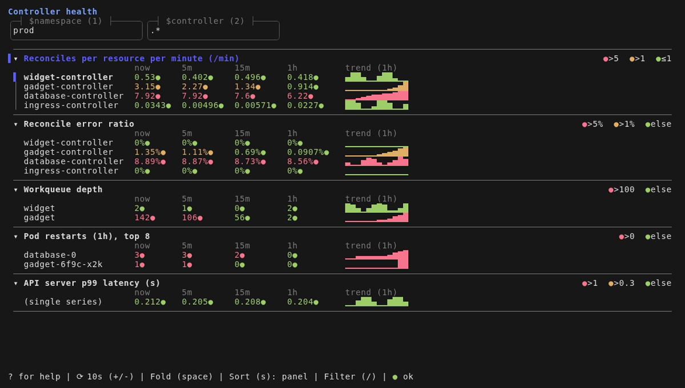
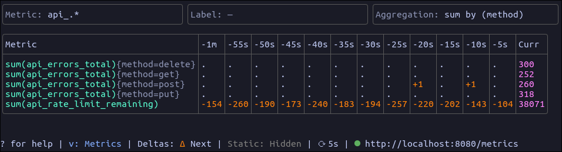
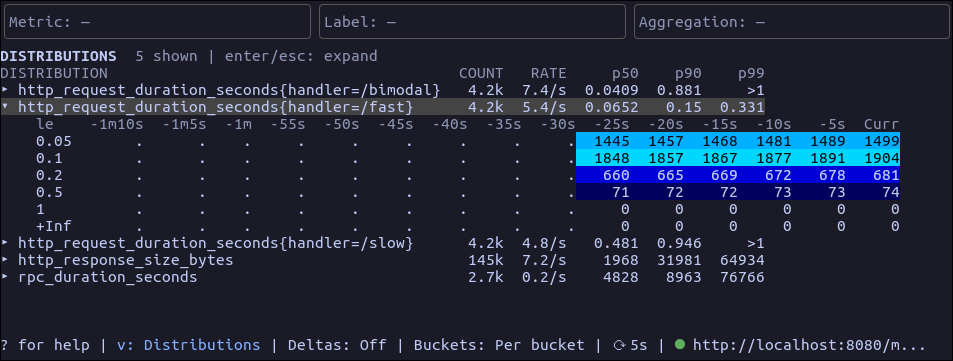
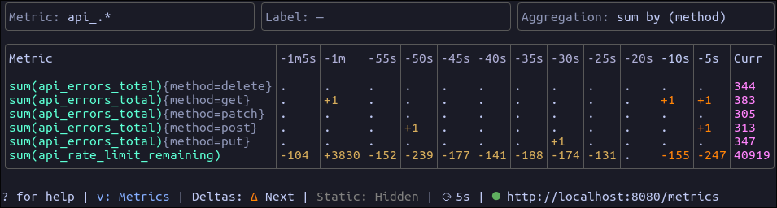

# omtui (openmetrics-tui)

Terminal tools for watching Prometheus/OpenMetrics metrics, with no server to
install.

**`omtui-dash`**: a PromQL dashboard in your terminal. Per-series tables across
time windows (`now`, `5m`, `1h`), sparklines and threshold colours show what is
unhealthy right now, and whether it was a minute ago. Works against any
Prometheus-compatible API, or in _managed mode_ scrapes the pods of your current
Kubernetes context for you.



**`omtui`**: a live viewer for a single `/metrics` endpoint, a better
`watch 'curl http://... | grep metric_*'`.



Jump to: [install omtui](#installation) · [install omtui-dash](#installing-omtui-dash) ·
[omtui-dash quick start](#quick-start) (no cluster needed)

# omtui: live metrics viewer

Distributions view:



Scrape epochs, after the target dropped out and came back (different colour for
each epoc):



Handing the screen to an AI agent? Press `S` to save a plain-text snapshot - see
[Plain-text snapshots](#plain-text-snapshots) below - and pass it along with
[README-AGENT-CONSUMERS.md](README-AGENT-CONSUMERS.md), which explains the
columns, colors and footer in detail.

## Installation

With Nix (flakes enabled):

```sh
nix run github:michaelvl/openmetrics-tui -- -url http://localhost:9100/metrics
nix profile install github:michaelvl/openmetrics-tui
```

With devbox:

```sh
devbox add github:michaelvl/openmetrics-tui
```

On NixOS, add the flake as an input and include
`inputs.openmetrics-tui.packages.${pkgs.system}.default` in
`environment.systemPackages`.

With Go:

```sh
go install github.com/michaelvl/openmetrics-tui/cmd/omtui@latest
```

The dashboard is installed the same way, from `cmd/omtui-dash`; see
[Installing omtui-dash](#installing-omtui-dash).

The binary is called `omtui`. It was previously called `openmetrics-tui`, so
the old binary name and the old `go install` path no longer work.

## Filtering and aggregation

Metrics can be filtered on metric name and labels and be aggregated on labels.

Each of the three takes the same syntax on the command line and in the TUI, so
the examples below show the value alone.

### Metric filter

An unanchored regex matched against the metric name. Pass it as
`-filter-metric`, or press `m` to edit it live (`enter` applies, `esc`
discards).

```
http_requests
^go_(gc|memstats)
requests_total|errors_total
```

### Label filter

A comma-separated list of clauses, all of which must match. Pass it as
`-filter-label`, or press `f` to edit it live. A missing label reads as the
empty string, the way PromQL treats it, so `env!=dev` also admits series with no
`env` label.

```
env=prod            label equals a value
env!=dev            label does not equal a value
env=~prod|stg       label matches a regex
env!~dev|test       label does not match a regex
code=               series lacking the label
env!=               series carrying the label, whatever its value
5..                 bare regex, tried against every label value (not its name)
env=prod,code=~5..  all clauses must match
path=~/a{1,2}       commas inside {} or [] need no escaping; use \, elsewhere
```

### Aggregation

Combines series that differ only in the labels you name. Pass it as
`-aggregation`, or press `a` to edit it live. The operator is optional and
defaults to `sum`; grouping never crosses metric names.

```
pod                 sum series that differ only in pod
pod,instance        sum over both labels
avg pod             avg, min, max and count also work
count               no grouping labels: one row per metric
sum by (pod)        the PromQL spelling, if you prefer it
```

Histograms fold with `sum` only; summaries are never folded and pass through
untouched.

### Label display

A label the filter pins to a value is dropped from the `{}` braces, because the
header already shows the filter and every visible series implicitly match. Under
`env=prod,code=~5..` a row reads `http_requests_total{method=GET}`, not
`{code=503,env=prod,method=GET}`.

A clause that pins nothing leaves its label alone: `env!=dev` admits prod and
staging both, so the column still says which one this row is. The same goes for
`env!~dev|test` and for a bare regex, which names no label to begin with.

Press `l` to cycle, or set `-label-mode`.

```
hide-filtered       the default described above
hide-all            no labels at all
all                 every label shown, filter or no filter
```

## Processing of metrics

The display has two independent axes. Deltas run _across time_, along a row, and
apply to every metric. Bucket mode runs _within a single sample_, down a
histogram's bounds. Neither knows about the other, so any pairing of the two
means what both names say it means, and both are shown at the bottom of the
screen.

### Deltas across time

Toggled with `d`, or set with `-delta-mode` (default `next`).

- `Deltas (d): Off` - metrics show raw.
- `Deltas (d): Δ Next` - metrics columns show the delta to the next in the time
  series, except for the current column, which show the raw metric value. _This
  makes changes over time easier to observe_.
- `Deltas (d): Δ View` - the current column shows the delta within the current view,
  i.e. the newest value less the oldest one still on screen, which is the sum of
  the deltas in the columns beside it.

A counter that falls has been restarted rather than measured, so the drop reads
as missing (`.`) instead of a large negative number. A gauge is free to fall,
and keeps its negative delta.

### Buckets within a sample

Toggled with `b`, in the distributions view. A histogram's buckets are
cumulative as exported Prometheus/OpenMetric data, i.e. `le=0.5` counts
everything `le=0.1` already counted.

- `Buckets (b): Cumulative` - counts exactly as the exporter published them, rising
  as you read down towards `+Inf`.
- `Buckets (b): Per bucket` - each bucket less the one below it, so a row counts
  only the observations that fell in that band. _This makes 'peaks' in the data
  easier to observe_.

Either way the counts are lifetime totals; pair them with `d` to see what
arrived recently. Summary quantiles are latencies rather than counts, so bucket
mode leaves them alone.

A two-bucket histogram, scraped three times, under each pairing:

```
                              t-2  t-1  Curr        t-2  t-1  Curr
Deltas: Off                    10   14    20         10   14    20   le=0.1
                               30   40    55         20   26    35   le=+Inf
Δ Next                          4    6    20          4    6    20   le=0.1
                               10   15    55          6    9    35   le=+Inf

                          Buckets: Cumulative    Buckets: Per bucket
```

## Scrape epochs

A failed scrape marks a break in the history, and the next successful scrape
starts a new _epoch_. That usually means the target restarted, so the values on
either side of the break come from two different processes. They shouldn't be
read as one continuous series.

Columns from before the most recent break are drawn in muted colours:
grey-lavender for raw values and muted orange for deltas. The newest epoch
always keeps the normal colours. If there's more than one break in the retained
history, the shading alternates at each one going back. In the
[epochs screenshot](docs/screen3.png), the column-header ages also jump from
`-20s` to `-10s`, which is where the break happened.

Deltas never cross a break, whatever the metric kind:

- In `Δ Next`, the column right before the break gets no delta, because the two
  samples next to it belong to different epochs.
- In `Δ View`, the current column only covers the newest epoch. It shows growth
  since the reconnect, not the two processes' counts added together.

## Plain-text snapshots

Press `S` (shift-s; lowercase `s` is the unrelated hide-static toggle) to save
the current view to `omtui-snapshot-<timestamp>.txt` in the working
directory. This is the preferred way to hand a screen to an AI agent instead of
an image screenshot - it carries exact numbers with no risk of OCR misreading
them.

A snapshot captures whichever view is on screen - the Metrics table or the
Distributions accordion - under whatever filters, aggregation, delta mode and
bucket mode are currently active, with colour escape codes stripped.

Unlike an actual screenshot, it is not clipped to the terminal's height: it
lists every row the current filters admit, as if the terminal were infinitely
tall. Width is still capped, though - the number of history or grid columns is
limited to whatever the terminal was wide enough to show at the time, exactly as
on screen. If a distribution family was zoomed (`enter` pressed twice), the
snapshot captures only that family full-screen, since zoom is a deliberate focus
rather than a height limitation.

The file opens with a short preamble:

```
# omtui snapshot, taken 2026-09-30T15:57:37Z
# For format explanation see https://raw.githubusercontent.com/michaelvl/openmetrics-tui/refs/heads/main/README-AGENT-CONSUMERS.md
```

That timestamp is the wall-clock moment the snapshot was taken - the column
headers inside the file are still relative ages (`-45s`, `Curr`, ...), measured
from it. The footer briefly echoes `saved <path>` (or a `snapshot
failed: ...`
error) in place of `? for help`, clearing itself again after a few seconds.

# omtui-dash: PromQL dashboard

`omtui-dash` renders a YAML-defined dashboard in the terminal. Each panel is one
PromQL query shown as a table of series with several time-window columns
(`now`, `5m`, `15m`, ...), a sparkline and threshold colours, so you can see at
a glance which controller, pod or queue is unhealthy right now and whether it
was a minute ago.

It reads from any Prometheus-compatible HTTP API (Prometheus, VictoriaMetrics,
Thanos, Mimir, ...). Alternatively, in _managed mode_ it starts its own
short-lived backend that scrapes pods in your current Kubernetes context, so
nothing has to be installed in the cluster.

## Installing omtui-dash

With Go:

```sh
go install github.com/michaelvl/openmetrics-tui/cmd/omtui-dash@latest
```

With Nix (flakes enabled):

```sh
nix run github:michaelvl/openmetrics-tui#omtui-dash -- --help
nix profile install github:michaelvl/openmetrics-tui#omtui-dash
```

The Nix package puts `victoria-metrics` on the `PATH` of `omtui-dash` (after any
`victoria-metrics` you already have), which managed mode needs. With `go
install` you install VictoriaMetrics yourself, or point `--vm-bin` at it.
`kubectl` is never bundled; managed mode uses your own.

## Quick start

No cluster is needed to try it. The mock server in this repository serves
synthetic data for the queries in `examples/controllers.yaml`:

```sh
make run-dash
```

which builds both programs, starts the mock on port 8080, runs the dashboard
against it and stops the mock again on exit. By hand, in two terminals:

```sh
go run ./cmd/mock-server -port 8080
go run ./cmd/omtui-dash --prom http://localhost:8080 examples/controllers.yaml
```

`make check-example` validates the example and runs each of its queries once.

Against a real backend:

```sh
omtui-dash --prom http://localhost:9090 my-dashboard.yaml
omtui-dash --prom http://localhost:9090 --var namespace=staging my-dashboard.yaml
```

## Backends

The backend is chosen in this order:

1. `--prom URL`: use an existing Prometheus-compatible API. Nothing is started.
   Credentials, if needed, are given with `--prom-token-file` (bearer token) or
   `--prom-user` plus `--prom-password-file`.
2. `--managed`: start `kubectl proxy` and a local VictoriaMetrics that scrapes
   pods through the Kubernetes API, using the current kubeconfig context (or
   `--kube-context`). `datasource.url` in the YAML is ignored. Both children
   are stopped when the dashboard exits.
3. Neither flag: use `datasource.url` from the YAML. If that is missing too,
   `omtui-dash` exits with a message listing the options.

`--prom` and `--managed` cannot be combined, and the managed-only flags are
rejected without `--managed`.

Managed mode, prerequisites, RBAC, cold start and caveats are covered in
[docs/kubernetes-local.md](docs/kubernetes-local.md).

```sh
omtui-dash --managed examples/controllers.yaml
omtui-dash --managed --kube-context staging --namespace prod --data-dir ~/.cache/omtui-dash my-dashboard.yaml
```

## Flags

Usage: `omtui-dash [flags] dashboard.yaml`. Go's flag package accepts `-flag`
and `--flag` alike.

| Flag | Meaning |
| --- | --- |
| `--check` | Validate the YAML, run every panel query once, print one status line per panel and exit non-zero if any panel failed. See [Checking a dashboard](#checking-a-dashboard). |
| `--var name=value` | Set a variable, overriding its `default`. Repeatable. The value must pass the variable's `pattern`; an unknown name is an error. |
| `--prom URL` | Prometheus-compatible API to query. Overrides `datasource.url`. |
| `--prom-token-file FILE` | File holding a bearer token for `--prom`. |
| `--prom-user USER` | Basic-auth user for `--prom`. |
| `--prom-password-file FILE` | File holding the basic-auth password. |
| `--managed` | Start `kubectl proxy` and a local VictoriaMetrics (managed mode). |
| `--kube-context NAME` | `kubectl` context for `--managed` (default: the current context). |
| `--namespace NS` | Scrape only this namespace; repeat for several. Overrides `scrape.namespaces`. |
| `--kubectl-bin PATH` | `kubectl` binary (default: `kubectl` on `PATH`). |
| `--vm-bin PATH` | `victoria-metrics` binary (default: `victoria-metrics` on `PATH`). |
| `--data-dir DIR` | Keep the managed storage in `DIR`, so history survives restarts. Default: a temporary directory removed on exit. |
| `--retention DUR` | Managed data retention (default `24h`). A unit suffix is required (`s m h d w M y`) and values below `24h` are rejected, because VictoriaMetrics does not accept them. |
| `--scrape-config FILE` | Use your own VictoriaMetrics scrape config instead of the generated one. `${KUBE_PROXY}` in it is replaced by the proxy address, `127.0.0.1:PORT`. |
| `--log-file FILE` | Append the output of `kubectl` and `victoria-metrics` to `FILE`. |

`--kube-context`, `--namespace`, `--kubectl-bin`, `--vm-bin`, `--data-dir`,
`--retention`, `--scrape-config` and `--log-file` only apply with `--managed`.

## Dashboard YAML reference

Unknown keys are errors, and every problem is reported with its line number.
`examples/controllers.yaml` is a complete, commented example.

```yaml
title: Controller health          # required
datasource:
  url: http://localhost:9090      # used when neither --prom nor --managed is given
refresh: 10s                      # default 10s, minimum 1s
windows: [now, 5m, 15m, 1h]       # the default; "now" first, then increasing
spark: 1h                         # sparkline range, default 1h
variables:
  namespace:
    default: prod
    pattern: '^[a-z0-9-]+$'
scrape:                           # managed mode only
  namespaces: [prod]
panels:
  - title: Reconcile error ratio  # required, unique
    query: |                      # required, PromQL
      sum by (controller) (rate(errors_total{namespace="${namespace}"}[5m]))
    label: "{{controller}}"
    unit: percent
    thresholds:
      - { gt: 0.05, color: red }
      - { gt: 0.01, color: yellow }
      - { color: green }
```

### Top level

| Key | Meaning |
| --- | --- |
| `title` | Required. Shown in the status line. |
| `datasource.url` | Backend URL when no flag chooses one. Must be a full URL. |
| `refresh` | Refresh interval, a duration such as `10s` or `1m`. Default `10s`. |
| `windows` | The value columns. See [Windows and `agg`](#windows-and-agg). |
| `spark` | Range of the sparkline. Default `1h`. Slots with no data are drawn as a faint `.`. |
| `variables` | Editable query parameters, see [Variables](#variables). At most 9. |
| `scrape` | Managed-mode scrape settings, see [Scrape section](#scrape-section). |
| `panels` | Required, at least one. |

Durations use the Prometheus syntax: `30s`, `5m`, `1h`, `1d`.

### Panels

| Key | Meaning |
| --- | --- |
| `title` | Required, unique within the dashboard. |
| `query` | Required. A PromQL query. Each series returned becomes a row. `${name}` is replaced by the value of a variable. The query is syntax-checked at load time. |
| `label` | Row title template. Only `{{labelname}}` substitutions are supported. Without it, or when a label is missing, the row is titled with the series labels as `{k=v,...}`. |
| `unit` | `percent` multiplies the value by 100 and adds `%`. `s` and `/min` show the plain number and add the unit to the panel title as `(s)` or `(/min)`; `none` or no unit adds nothing. Thresholds always compare the raw value. |
| `thresholds` | Colour rules, see below. |
| `sort` | `asc` or `desc` by the `now` column. Without it the response order is kept. |
| `limit` | Keep only the first N rows after sorting, so `sort: desc` with `limit` is a top-N. |
| `agg` | `avg`, `max` or `min`, see below. |
| `folded` | Start the panel folded to a single summary line. Default `false`. |

### Thresholds

An ordered list, evaluated per cell; the first match wins. Each entry has a
`color` and at most one comparison: `gt`, `gte`, `lt` or `lte`. An entry with no
comparison is the catch-all and must come last. A cell that matches nothing is
drawn uncoloured.

```yaml
thresholds:
  - { gt: 5, color: red }
  - { gt: 1, color: yellow }
  - { color: green }
```

`color` is `red`, `yellow`, `green`, `orange`, `blue`, `purple`, `cyan` or
`grey`; any other value is passed to the terminal as a colour name or number
(for example `"213"` or `"#ff8800"`).

Each colour is drawn with a marker, so status still reads without colour. The
default has a distinct shape per colour: `▲` red, `◆` orange, `■` yellow, `●`
anything else. Set `symbol` on an entry to use another single, one-column-wide
character, for example `{ gt: 5, color: red, symbol: "✗" }`.

### Windows and `agg`

`windows` is one list of offsets, `now` first, each larger than the one before.
By default a column shows the value at `end - offset` (the instant, snapped to
the nearest query step), so `5m` is the value five minutes ago.

Set `agg` on a panel to show instead the aggregate over the trailing window
`[end - offset, end]` for every column except `now`. The `15m` column of an `agg: max`
panel then shows the maximum over the last fifteen minutes. All columns and the
sparkline come from one range query per panel.

### Variables

```yaml
variables:
  namespace:
    default: prod
    pattern: '^[a-z0-9-]+$'
  controller:
    default: ".*"
    regex: true
```

Variables are referenced in queries as `${name}` and shown in the header as
`$name`. Each gets a header box opened by the number key of its declaration
order (`1` to `9`).

| Key | Meaning |
| --- | --- |
| `default` | Required. The initial value. `--var` overrides it. |
| `pattern` | Regex a value must match before it is substituted. Default `^[A-Za-z0-9_.:/-]*$`. |
| `regex` | `true` allows regex metacharacters (for `label=~"${name}"` matchers); the value must then be a valid regex. With `regex: true` and no `pattern`, any valid regex is accepted. |
| `options` | Where suggestions come from, see below. |

Substituted values are escaped for a PromQL string literal, so a value can never
break out of the matcher it sits in. A variable no query uses produces a
warning.

Suggestions in the edit box are derived automatically: a matcher such as
`namespace="${namespace}"` or `controller=~"${controller}"` in a query names the
label and the surrounding selector, and the values come from the backend's
label-values API. Other variables are substituted with their current values, so
the lists cascade. `options` overrides this:

```yaml
options: [prod, staging]                                   # fixed list
options: { label_values: { metric: kube_pod_info, label: namespace } }
options: false                                             # free text only
```

If the lookup fails or returns nothing, the box is free text. A typed value that
is not in the list is still accepted if it matches `pattern`.

Variables only filter queries. They do not change what managed mode scrapes.

### Scrape section

Used only with `--managed`; ignored otherwise. It controls what the generated
scrape config collects.

| Key | Meaning |
| --- | --- |
| `namespaces` | Required when the section is present. Namespaces to scrape. `--namespace` overrides it. |
| `interval` | Scrape interval, at least `1s`. Default `15s`. |
| `selector` | A pod label selector, such as `app=my-controller`. Cannot be combined with `annotation`. |
| `annotation` | Annotation name that opts a pod in when set to `"true"`, such as `prometheus.io/scrape`. In this mode `port` and `path` name annotations. |
| `port` | Annotation mode: the annotation holding the port (default `prometheus.io/port`). Otherwise a port number. |
| `path` | Annotation mode: the annotation holding the path (default `prometheus.io/path`, falling back to `/metrics`). Otherwise a literal path starting with `/` (default `/metrics`). |

Only pods in phase `Running` are scraped, and a pod must declare at least one
container port to become a target. Without a `scrape` section, every Running
pod with a declared container port in all namespaces is scraped. Without
`annotation` and `port`, every declared container port of a matching pod is
scraped, so set `port` for precision. See
[docs/kubernetes-local.md](docs/kubernetes-local.md) for the details and
limits.

## Key bindings

| Key | Action |
| --- | --- |
| `1` to `9` | Edit variable by number. `Enter` applies, `Esc` cancels, `Tab` / `Shift+Tab` applies and moves to the next or previous box. `Up` / `Down` choose a suggestion and `Tab` or `Enter` accepts it. |
| `Tab` / `Shift+Tab` | Next / previous panel. |
| `Up` `Down` / `k` `j` | Previous/next panel. In a panel taller than the screen they scroll through it first. |
| `Space` / `Enter` | Fold or unfold the active panel. |
| `z` | Fold all panels, or unfold all if all are folded. |
| `s` | Cycle sort: the panel's YAML order, `now` descending, `now` ascending, label. |
| `/` | Filter rows by case-insensitive substring of the row title, live as you type. `Enter` keeps it, `Esc` discards it. |
| `r` | Refresh now. |
| `p` | Pause or resume refreshing. |
| `+` / `-` | Shorter / longer refresh interval (1s up to 5m). |
| `PgUp` `PgDn` `Home` `End` | Scroll the dashboard. |
| `S` | Save a plain-text snapshot to `omtui-dash-snapshot-<timestamp>.txt` in the working directory. |
| `L` | Managed mode: show the `kubectl` / VictoriaMetrics log. |
| `R` | Managed mode: restart a failed child process. |
| `?` | Help. |
| `q`, `Ctrl+C` | Quit. |

While a variable box or the filter is open, every key goes to the input,
including digits and `q`.

A folded panel shows `▸ title`, the number of rows per colour and the worst row.
Folded panels keep querying, so a fully folded dashboard is a live overview. A
panel that fails shows its error on the panel without blanking the others.

## Checking a dashboard

```sh
omtui-dash --check --prom http://localhost:9090 my-dashboard.yaml
```

`--check` loads and validates the YAML (including PromQL syntax of every query,
with variable defaults substituted), then runs each query once against the
backend and prints a line per panel:

```
ok    Workqueue depth: 2 rows
ok    Pod restarts (1h): 0 rows (no data)
FAIL  API server p99 latency: ...
```

The exit status is `0` when every panel ran, `1` if a panel failed or the
backend could not start, and `2` for usage errors. Validation errors are
reported without contacting the backend. The command is suitable for CI, with the backend being the mock
server or a real one. `make check-example` does this for the bundled example.
A panel that returns no series counts as a success and is flagged `(no data)`.
